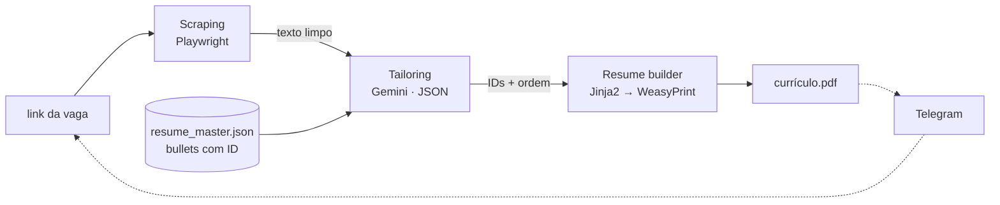

<div align="center">


</div>

<br />

Bot pessoal que automatiza parte da candidatura a vagas. A partir do link de uma vaga (hoje, Gupy), ele extrai a descrição, usa o **Gemini** para escolher e ordenar os bullets do currículo mestre mais relevantes para aquela vaga e gera o **PDF do currículo sob medida**. Também rascunha respostas para perguntas do formulário e pode ser operado pelo **Telegram**.

### `> pipeline`



1. **Scraping** (`scrapers/`): abre a vaga com Playwright e extrai descrição e requisitos, descartando ruído institucional como benefícios e redes sociais.
2. **Tailoring** (`tailoring/`): envia a vaga e os bullets do currículo mestre, cada um com um ID, para o Gemini. A resposta é JSON estruturado (`response_mime_type="application/json"`) e a temperatura é baixa, para a seleção ser consistente.
3. **Resume builder** (`resume_builder/`): renderiza um template HTML com os bullets escolhidos e converte para PDF.
4. **Notifier** (`notifier/`): bot do Telegram que recebe o link e devolve o PDF, ou gera respostas para as perguntas do formulário.

### `> decisão central: o LLM seleciona, não escreve`

O modelo **devolve só IDs e a ordem dos bullets**, nunca texto reescrito. Isso elimina o risco de alucinação, porque o currículo final só contém experiências que existem no `resume_master.json`. O LLM é usado para o que ele faz bem, que é julgar relevância, e a parte factual fica determinística.

### `> instalação`

```bash
python -m venv .venv
source .venv/bin/activate          # Windows: .venv\Scripts\activate
pip install -r requirements.txt
playwright install chromium
cp .env.example .env
```

| Variável | Descrição |
|---|---|
| `GEMINI_API_KEY` | chave do Gemini ([aistudio.google.com/apikey](https://aistudio.google.com/apikey), free tier) |
| `TELEGRAM_BOT_TOKEN` | token do bot (opcional, criado no [@BotFather](https://t.me/BotFather)) |
| `TELEGRAM_CHAT_ID` | seu chat ID (opcional) |

Preencha `job-apply-bot/data/resume_master.json` com experiências, projetos e skills. Cada bullet precisa de um `id` único.

### `> uso`

O `main.py` importa módulos de `job-apply-bot/`, então rode a partir da raiz com o `PYTHONPATH` configurado:

```bash
# currículo sob medida para uma vaga
PYTHONPATH=job-apply-bot python main.py link "https://portal.gupy.io/job-search/..."

# currículo + respostas para perguntas do formulário (digitadas no terminal)
PYTHONPATH=job-apply-bot python main.py link "https://portal.gupy.io/job-search/..." --answers

# buscar vagas pelos filtros de config.py (JOB_FILTERS)
PYTHONPATH=job-apply-bot python main.py search

# bot do Telegram
PYTHONPATH=job-apply-bot python job-apply-bot/notifier/telegram_bot.py
```

### `> estrutura`

```
main.py                     CLI
job-apply-bot/
├── config.py               paths, chaves, filtros de vaga
├── errors.py               erros técnicos → mensagens legíveis
├── pipeline.py             scraping → tailoring → PDF
├── data/resume_master.json currículo mestre (fonte única de verdade)
├── scrapers/               extração por plataforma
├── tailoring/              cliente do Gemini
├── resume_builder/         template HTML + PDF
└── notifier/               bot do Telegram
```

> Projeto pessoal, para uso individual. Respeite os termos de uso das plataformas de vagas ao automatizar scraping e candidaturas.

<div align="center">
<br />
<sub>Desenvolvido por <a href="https://github.com/cm0420">Miguel Costa</a></sub>
</div>
